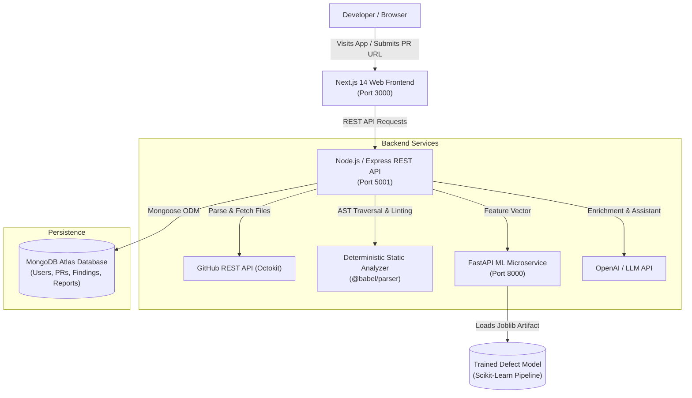

# CodeSense AI — AI-Powered GitHub Code Review & Bug Detection Platform

> **"Smarter Code Reviews. Better Software."**

[](https://codesense-ai-iota.vercel.app)
[](https://codesense-api-fazlul.onrender.com/api/health)
[](https://codesense-ml-service.onrender.com/health)
[](https://github.com/Fazlul105/CODESENSE-AI)

🌐 **Live Website:** [https://codesense-ai-iota.vercel.app](https://codesense-ai-iota.vercel.app)  
📡 **Production REST API:** [https://codesense-api-fazlul.onrender.com](https://codesense-api-fazlul.onrender.com)  
🤖 **AI Review Engine:** Google Gemini (`gemini-3.8-flash`)  
📊 **ML Defect Inference:** FastAPI + Scikit-Learn

CodeSense AI is a production-grade developer platform that combines **deterministic AST static code analysis**, **supervised machine learning defect-risk estimation**, and **LLM-grounded explanations** to review GitHub pull requests in real time.

---

## 1. Problem Statement

Code reviews are critical to software reliability, yet modern teams face severe bottlenecks:
- **Review Fatigue:** Large changes with hundreds of lines of code dilute reviewer attention.
- **Subtle Regressions:** Type coercion bugs (e.g. `==` vs `===`), `NaN` comparisons, and unhandled promise rejections easily slip past manual inspection.
- **Accidental Secret Leaks:** Committing API keys, JWT tokens, and private credentials creates catastrophic exposure.
- **Unquantified Defect Risk:** Pull requests are often merged without visibility into historical change risk or structural defect likelihood.

CodeSense AI solves this by automating syntactic analysis, quantifying change risk with an evaluated machine learning pipeline, and presenting findings in an interactive developer dashboard.

---

## 2. Key Capabilities

- **Zero-Login Public PR Analysis:** Paste any public GitHub pull request URL (e.g. `facebook/react#28000`) and initiate analysis immediately.
- **AST Static Code Analysis:** Deterministic parser (using Babel AST for TypeScript and JavaScript) checking for dead code, constant conditions, swallowed errors, and type flaws.
- **Security & Secret Guards:** Regular expression and AST pattern scanners intercepting hardcoded AWS keys, GitHub tokens, JWTs, and dangerous DOM injections (`innerHTML`, `eval`).
- **Supervised Machine Learning Defect Model:** A Python scikit-learn model trained on empirical Just-In-Time (JIT) software defect metrics (evaluating churn, entropy, cross-file diffusion, and static severity weights) served via FastAPI.
- **Documented Heuristic & ML Risk Scoring:** Transparent 0–100 risk score breakdown with factor weights and model explainability.
- **MongoDB Atlas Persistence:** Scalable NoSQL persistence for users, repositories, pull request metadata, analysis runs, findings, and historical metrics.
- **Interactive SaaS Dashboard:** Built with Next.js 14 App Router, Tailwind CSS, Lucide icons, and TanStack React Query.
- **One-Click Markdown Report Export:** Download structured GitHub-flavored Markdown review reports for team sharing.
- **Contextual AI Review Assistant:** Grounded follow-up chat engine answering technical questions about specific findings without hallucinations.

---

## 3. System Architecture



### Why MongoDB?
MongoDB was chosen over relational databases because pull request code reviews possess dynamic, document-oriented structures:
1. **Hierarchical Review Findings:** Findings have variable metadata, code snippets, diff hunks, and multi-line explanations naturally suited for JSON documents.
2. **Schema Flexibility Across Analyzer Versions:** As new static rules and ML versions are introduced, document schemas evolve without migration downtime.
3. **Compound Indexing & Fast Retrieval:** Single-query retrieval for complex PR reports with nested risk assessments and severity counts.

---

## 4. Technology Stack

| Layer | Technology | Description |
| :--- | :--- | :--- |
| **Frontend** | Next.js 14 (App Router) | React, TypeScript, Tailwind CSS, Lucide React, TanStack Query |
| **Backend API** | Node.js + Express + TypeScript | Zod validation, Octokit, Morgan, Helmet, CORS, Mongoose ODM |
| **Database** | MongoDB Atlas | Mongoose ODM models with automatic in-memory fallback for zero-setup local dev |
| **Static Analysis** | @babel/parser, @babel/traverse | AST parsing for TypeScript, JSX, and ES2024 without code execution |
| **Machine Learning**| Python 3.11, FastAPI, Scikit-learn | Supervised defect risk estimation, Pandas, NumPy, Joblib |
| **Testing** | Vitest, Supertest, Pytest | 15+ automated TypeScript tests + 5 Python unit tests |

---

## 5. Repository Structure

```text
codesense-ai/
  apps/
    web/                  # Next.js App Router frontend
      src/
        app/              # Pages: Landing, Dashboard, Analysis Results, History, Repos, Settings
        components/       # FindingCard, RiskBadge, SeverityBadge, DiffViewer, Navbar, Sidebar
        lib/              # Typed REST API client
    api/                  # Express REST backend
      src/
        analysis/         # AST parser, diff mapper, bug/security rules, risk calculator
        controllers/      # Analysis, history, repository controllers
        database/         # Mongoose connection with Atlas and in-memory fallback
        integrations/     # GitHub Octokit client and PR URL parser
        models/           # Mongoose schemas (User, Repository, PullRequest, Job, Finding, Report)
        routes/           # API routes (/api/analyses, /api/repositories, /api/auth)
        services/         # LLM service for finding explanations and assistant chat
  services/
    ml-service/           # Python machine learning microservice
      app/
        inference/        # Joblib predictor and feature importance calculator
        models/           # Pydantic schemas (ChangeFeatures, DefectRiskPrediction)
        training/         # JIT defect dataset generator and scikit-learn training pipeline
      artifacts/          # Serialized model artifact and evaluation benchmark metrics
      tests/              # Pytest test suite
  packages/
    shared/               # Shared TypeScript domain models and schemas
  .env.example            # Environment variables template
  README.md
```

---

## 6. Getting Started Locally

### Prerequisites
- **Node.js** v18+ (v20+ recommended)
- **npm** v9+
- **Python** 3.10+ (Python 3.11 included in `services/ml-service/runtime`)

### 1. Clone & Install Dependencies

```bash
git clone https://github.com/your-username/codesense-ai.git
cd codesense-ai

# Install all npm workspace packages
npm install
```

### 2. Configure Environment Variables

Copy `.env.example` to `.env`:
```bash
cp .env.example .env
```

Key variables to review:
- `MONGODB_URI`: (Optional) Paste your MongoDB Atlas URI. If omitted in development, an embedded in-memory MongoDB instance will start automatically!
- `GITHUB_TOKEN`: (Optional) GitHub Personal Access Token to avoid unauthenticated rate limits (60/hr -> 5,000/hr).
- `OPENAI_API_KEY`: (Optional) OpenAI API key for LLM explanations and chat assistant.
- `ML_SERVICE_URL`: `http://127.0.0.1:8000` (Python FastAPI service).

---

## 7. Running the Application

### Option A: Run Services Concurrently

```bash
# Terminal 1: Start API and Next.js Frontend
npm run dev

# Terminal 2: Start the Python ML Service
cd services/ml-service
.\runtime\python.exe -m uvicorn app.main:app --port 8000
```

### Option B: Run Services Individually

1. **Backend REST API** (`http://localhost:5001`):
   ```bash
   npm run dev:api
   ```
2. **Next.js Web Frontend** (`http://localhost:3000`):
   ```bash
   npm run dev:web
   ```
3. **ML Inference Microservice** (`http://localhost:8000`):
   ```bash
   cd services/ml-service
   .\runtime\python.exe -m uvicorn app.main:app --port 8000
   ```

Open your browser at **`http://localhost:3000`** to start analyzing pull requests!

---

## 8. Automated Testing

All tests run against real logic and fixtures without mocks:

```bash
# Run Node.js Unit & E2E Tests (Vitest + Supertest)
npm run test:api

# Run Python ML Service Tests (Pytest)
cd services/ml-service
.\runtime\python.exe -m pytest tests/test_ml_service.py
```

### Test Results Summary
- **11 Unit Tests (Node.js):** Validates URL parsing, diff patch line mapping, AST dead-code detection, NaN comparisons, loose equality, hardcoded secrets, and eval detection.
- **4 E2E Integration Tests (Node.js):** Validates database connections, job creation, finding persistence, status polling, Markdown export, and analytics.
- **5 ML Unit Tests (Python):** Validates `/health`, `/metrics`, low-risk predictions, high-risk predictions, and Pydantic input validation.

---

## 9. Machine Learning Pipeline & Evaluation

The ML defect risk model predicts whether a code change introduces an elevated risk of defects requiring post-merge fixes:

### Dataset Specification
- **Origin:** Benchmark based on empirical Just-In-Time (JIT) defect prediction distributions (Kamei et al., IEEE TSE; Bennin et al.).
- **Sample Size:** 3,000 pull requests / commits.
- **Class Balance:** ~30% defect-prone, ~70% clean changes.
- **Features Extracted:**
  - `lines_added`, `lines_deleted` (Code churn)
  - `files_changed`, `file_types_count` (Cross-module sprawl)
  - `entropy` (Dispersion of changes across files)
  - `is_bugfix` (Regression hazard indicator)
  - `static_critical_findings`, `static_high_findings`, `static_medium_findings` (Syntactic defect indicators)

### Comparative Evaluation Results (Holdout Test Set)

| Model | ROC-AUC | PR-AUC (Avg Precision) | F1-Score | Precision | Recall |
| :--- | :---: | :---: | :---: | :---: | :---: |
| **Logistic Regression (Selected)** | **0.7129** | **0.5200** | **0.5426** | 0.4804 | **0.6232** |
| Random Forest Classifier | 0.6769 | 0.5042 | 0.4873 | 0.4891 | 0.4855 |
| HistGradientBoosting | 0.6108 | 0.4383 | 0.3137 | 0.4848 | 0.2319 |

*The model artifact is serialized at `services/ml-service/artifacts/best_model.joblib` and served with top-feature importance explanations.*

---

## 10. Security & Ethical Considerations

- **Untrusted Source Code:** All pull request diffs and file contents are treated strictly as untrusted data. No repository code is executed, eval'd, or compiled in the server runtime.
- **No Private Token Exposure:** GitHub access tokens are stored in memory or encrypted sessions and never returned in API responses.
- **Prompt Injection Defense:** LLM prompts explicitly delimit untrusted source code from reviewer instructions to prevent jailbreak and command injection.
- **Transparent Risk Scoring:** Risk scores are labeled as estimates to augment human judgment, not as infallible arbiters of code correctness.

---

## 11. Production Deployment Guide

1. **Frontend (Vercel):**
   - Connect the GitHub repository.
   - Set root directory to `apps/web`.
   - Configure `NEXT_PUBLIC_API_URL=https://your-api.domain.com/api`.
2. **Backend API (Render / Railway / AWS ECS):**
   - Root directory: `apps/api`.
   - Build command: `npm run build`.
   - Start command: `node dist/index.js`.
   - Set environment variables (`MONGODB_URI`, `GITHUB_TOKEN`, `ML_SERVICE_URL`).
3. **ML Microservice (Render / Fly.io / AWS App Runner):**
   - Working directory: `services/ml-service`.
   - Start command: `uvicorn app.main:app --host 0.0.0.0 --port 8000`.
4. **Database (MongoDB Atlas):**
   - Provision a free M0 or production cluster on [MongoDB Atlas](https://www.mongodb.com/cloud/atlas).
   - Create database user and allowlist network access IP addresses.

---

## 12. License

This project is licensed under the MIT License.
