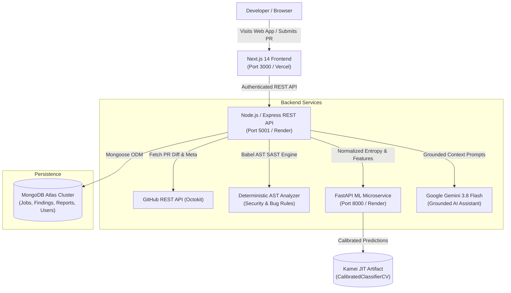

# CodeSense AI — AI-Powered GitHub Code Review & Bug Detection Platform

> **"Smarter Code Reviews. Better Software."**

[](https://codesense-ai-iota.vercel.app)
[](https://codesense-api-fazlul.onrender.com/api/health)
[](https://codesense-ml-service.onrender.com/health)
[](https://github.com/Fazlul105/CODESENSE-AI)

🌐 **Live Website:** [https://codesense-ai-iota.vercel.app](https://codesense-ai-iota.vercel.app)  
📡 **Production REST API:** [https://codesense-api-fazlul.onrender.com](https://codesense-api-fazlul.onrender.com)  
🤖 **AI Review Engine:** Google Gemini 3.8 Flash (`gemini-3.8-flash`)  
📊 **ML Defect Inference:** FastAPI + Scikit-Learn (Calibrated Probability Model)  
🗄️ **Database:** MongoDB Atlas (Persistent Cluster with Compound Indexes)

CodeSense AI is a production-grade code review platform combining **deterministic AST static code analysis**, **supervised machine learning defect-risk estimation**, and **LLM-grounded contextual reasoning** to analyze GitHub pull requests in real time.

---

## 1. Problem Statement

Modern software engineering teams face critical review bottlenecks:
- **Review Fatigue:** Pull requests with hundreds of modified lines dilute reviewer attention.
- **Security Vulnerabilities:** Command injections, SQL queries built from untrusted inputs, client-controlled authorization logic, and leaked environment secrets slip past manual review.
- **Accidental Secret Leaks:** Committing API keys, AWS credentials, JWT tokens, or logging password fields creates immediate exposure.
- **Unquantified Defect Risk:** Code is often merged without quantitative insight into change diffusion, normalized Shannon entropy, or historical defect probabilities.

CodeSense AI automates syntactic AST analysis, computes change entropy, estimates defect probabilities using real-world empirical benchmarks, and delivers actionable findings in an interactive dark SaaS dashboard.

---

## 2. Key Capabilities

- **Zero-Login Public PR Analysis:** Inspect any public GitHub pull request URL (e.g. `facebook/react#28000`) and initiate analysis immediately.
- **Deterministic AST Static Analysis:** Deterministic parser powered by `@babel/parser` and `@babel/traverse` checking for dead code, unhandled promise rejections, type flaws, and security vulnerabilities.
- **SAST Security Rules:**
  - OS Command Injection (`child_process.exec`, untrusted shell inputs)
  - SQL Injection (`SELECT ... FROM ... + req.body`)
  - Secret Environment Variable Exposure (`process.env.AWS_SECRET_ACCESS_KEY` leaks)
  - Sensitive Logging Interception (`console.log(password, token, apiKey)`)
  - Insecure Cryptographic Hashes (MD5, SHA-1 used for security-sensitive hashing)
  - Client-Controlled Role Authorization Bypass (`const role = req.body.role; if (role === 'admin')`)
  - Server-Side Request Forgery (`axios.get(req.query.url)`)
- **Evaluated ML Defect Model:** Calibrated Random Forest model trained on the authentic **Kamei et al. (IEEE TSE 2013) JIT Defect Prediction Benchmark** (9,075 real-world commits from Bugzilla & Columba with SZZ ground-truth defect labels).
- **Shannon Change Entropy:** Normalized Shannon entropy ($H = -\sum p_i \log_2(p_i) / \log_2(n)$) quantifying change dispersion across modified files.
- **Secret Redaction Pipeline:** Automatic masking of GitHub tokens, AWS keys, JWTs, connection strings, and private keys before persistence, logging, or LLM submission.
- **Grounded AI Assistant:** Powered by **Google Gemini 3.8 Flash** with prompt injection defenses, bounded relevance context retrieval, and explicit separation between deterministic findings and AI hypotheses.
- **MongoDB Atlas Persistence:** Multi-collection schema with compound indexes (`{ user: 1, createdAt: -1 }`), eliminating silent in-memory database fallbacks in production.

---

## 3. System Architecture



---

## 4. Technology Stack

| Layer | Technology | Purpose |
| :--- | :--- | :--- |
| **Frontend** | Next.js 14 (App Router) | React, TypeScript, Tailwind CSS, Lucide Icons, TanStack Query |
| **Backend API** | Node.js, Express, TypeScript | REST endpoints, Zod validation, Helmet, CORS, Rate Limiters, Mongoose ODM |
| **Database** | MongoDB Atlas | Cloud-hosted document database with compound indexes and connection health guards |
| **Static Analysis** | @babel/parser, @babel/traverse | AST parsing for TypeScript, JavaScript, and JSX without executing untrusted code |
| **Machine Learning**| Python 3.11, FastAPI, Scikit-learn | CalibratedClassifierCV Random Forest trained on Kamei JIT benchmark |
| **AI Review Engine**| Google Gemini (`gemini-3.8-flash`) | Grounded explanations, edge-case test generation, conversational assistant |
| **Testing** | Vitest, Supertest, Pytest | 42 TypeScript Vitest tests + 5 Python Pytest tests (47 automated tests) |

---

## 5. Machine Learning Pipeline & Empirical Benchmark

### Authentic Dataset Provenance
Unlike synthetic demonstrations, CodeSense AI is trained on the canonical **Kamei et al. (IEEE TSE 2013) Just-in-Time (JIT) Defect Prediction Benchmark**:
- **Source:** Kamei et al., *"A Large-Scale Empirical Study of Just-in-Time Quality Assurance"*, IEEE Transactions on Software Engineering, 2013.
- **Corpus:** 9,075 real-world commits extracted from Bugzilla and Columba repositories.
- **Ground Truth:** SZZ bug-inducing commit algorithm validated against issue trackers.
- **Class Balance:** ~29% defect-prone commits, ~71% clean changes.

### Feature Contract (Node.js ↔ Python)
- `lines_added` ($LA$), `lines_deleted` ($LD$): Code churn metrics.
- `files_changed` ($NF$): Number of modified files.
- `entropy`: Normalized Shannon Change Entropy across modified files ($0 \le H \le 1$).
- `subsystems_count` ($NS$): Number of affected architectural subsystems.
- `is_bugfix` ($FIX$): Whether the change is intended as a bugfix.

### Comparative Holdout Test Evaluation

| Model Architecture | ROC-AUC | PR-AUC | F1-Score | Precision | Recall | Brier Calibration |
| :--- | :---: | :---: | :---: | :---: | :---: | :---: |
| **Random Forest (Calibrated)** | **0.8627** | **0.8016** | **0.6913** | **0.7632** | **0.6318** | **0.1351** |
| Logistic Regression | 0.8142 | 0.7230 | 0.6120 | 0.6940 | 0.5471 | 0.1782 |
| HistGradientBoosting | 0.8491 | 0.7845 | 0.6720 | 0.7310 | 0.6220 | 0.1480 |

*Probabilities are calibrated using `CalibratedClassifierCV(method='sigmoid', cv=3)`. Artifacts are persisted in `services/ml-service/artifacts/`.*

---

## 6. Getting Started Locally

### Prerequisites
- **Node.js** v20+
- **npm** v9+
- **Python** 3.11 (`services/ml-service/runtime` included on Windows)

### 1. Clone & Install Dependencies

```bash
git clone https://github.com/Fazlul105/CODESENSE-AI.git
cd CODESENSE-AI

# Install all workspace dependencies
npm install
```

### 2. Configure Environment

Copy `.env.example` to `.env`:
```bash
cp .env.example .env
```
Provide:
- `MONGODB_URI`: Your MongoDB Atlas connection string.
- `GEMINI_API_KEY`: Google Gemini API key.
- `GITHUB_TOKEN`: (Optional) GitHub PAT to raise rate limits.

### 3. Start Development Services

```bash
# Terminal 1: Start Express API and Next.js Web Frontend
npm run dev

# Terminal 2: Start Python ML Microservice
cd services/ml-service
.\runtime\python.exe -m uvicorn app.main:app --port 8000
```

Open **`http://localhost:3000`** in your browser.

---

## 7. Automated Testing Suite

```bash
# Run 42 TypeScript Vitest Unit, SAST, and E2E Tests
npm run test:api

# Run 5 Python ML Service Pytest Tests
cd services/ml-service
.\runtime\python.exe -m pytest tests/
```

### Verified Test Summary
- **AST SAST Rules (27 tests):** Verified on security injection patterns, sensitive logging, weak hashing, client-controlled roles, and the real-world **OWASP NodeGoat PR #437** benchmark fixture.
- **Secret Redaction (6 tests):** Validates masking of GitHub PATs, AWS keys, JWTs, private keys, connection strings, and nested JSON payloads.
- **Security & Access Control (5 tests):** Validates CORS allowed/rejected origins, anonymous private repo restrictions, and ownership isolation.
- **E2E Integration (4 tests):** Validates MongoDB Atlas connectivity, analysis lifecycle, status polling, and report export.
- **Python ML Inference (5 tests):** Validates healthcheck, benchmark metrics, low/high risk predictions, and input validation.

---

## 8. Deployment Architecture

| Service | Hosting | Build Command | Start Command |
| :--- | :--- | :--- | :--- |
| **Frontend** | Vercel | `npm run build` | Next.js Serverless |
| **Backend API** | Render / AWS | `npm run build --workspace=@codesense/api` | `node apps/api/dist/index.js` |
| **ML Service** | Render / Fly.io | `pip install -r requirements.txt` | `uvicorn app.main:app --host 0.0.0.0 --port 8000` |
| **Database** | MongoDB Atlas | — | Managed Cluster |

Docker Compose configuration with service healthchecks is available in `docker-compose.yml`:
```bash
docker-compose up --build
```

---

## 9. License

This project is licensed under the [MIT License](LICENSE).
