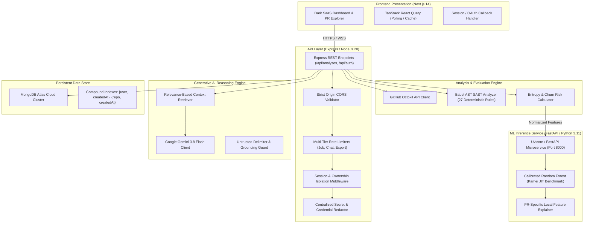

# CodeSense AI — Architecture & System Design

## 1. Executive Architecture Overview

CodeSense AI is architected as an event-driven, microservices-augmented monorepo designed for high-throughput, low-latency automated code review and defect prediction.

---

## 2. Component Specifications

### 2.1 Workspace Structure (npm Workspaces)
- `apps/web`: Next.js 14 App Router application deployed on Vercel. Consumes typed endpoints from `@codesense/shared` and `@/lib/api`.
- `apps/api`: Node.js Express TypeScript service exposing secure REST endpoints, managing GitHub integration, AST analysis, and MongoDB Atlas persistence.
- `packages/shared`: Shared TypeScript domain models (`AnalysisJob`, `ReviewFinding`, `RiskAssessment`, `Severity`, `PullRequestMetadata`).
- `services/ml-service`: Standalone Python 3.11 FastAPI microservice delivering calibrated defect-risk probability inference.

### 2.2 Data Flow Pipeline

1. **Submission & Ingestion:**
   - The user submits a public or private GitHub PR URL (e.g., `https://github.com/facebook/react/pull/28000`).
   - The API validates the URL format using Zod schemas and checks user permissions (anonymous users restricted to public repositories).
2. **Metadata & Diff Extraction:**
   - Express queries GitHub Octokit to fetch pull request metadata (base branch, head branch, additions, deletions, author).
   - Patches are pulled for modified files; unsupported, binary, or configuration files are flagged and accounted for in the Codebase Coverage metric.
3. **Deterministic AST Static Code Analysis (SAST):**
   - Supported JavaScript/TypeScript files are parsed into Abstract Syntax Trees using `@babel/parser`.
   - The `@babel/traverse` walker evaluates AST nodes against 27 deterministic rules covering security injection, credential leaks, insecure cryptography, and language anti-patterns.
4. **Change Diffusion & Entropy Calculation:**
   - Lines added and deleted per file are computed.
   - Normalized Shannon Change Entropy is computed across modified files to measure architectural dispersion:
     $$H = -\sum_{i=1}^n p_i \log_2(p_i) \bigg/ \log_2(n)$$
5. **Machine Learning Inference:**
   - A standardized feature contract is dispatched via HTTP POST to the FastAPI microservice (`http://ml-service:8000/predict`).
   - A probability-calibrated Random Forest (`CalibratedClassifierCV`) scores the change against the Kamei et al. empirical benchmark.
   - PR-specific local feature deviations are returned as contributing risk factors.
6. **Persistence & LLM Context Grounding:**
   - Findings, metrics, and report details are redacted via `redactSensitiveData` and persisted to MongoDB Atlas.
   - The grounded Gemini assistant utilizes relevance-based retrieval to provide context-aware technical reasoning and remediation patches.

---

## 3. Database Schema & Indexing Strategy

All models are defined in `apps/api/src/models/` using Mongoose:
- **`AnalysisJob`**:
  - `user`: ObjectId reference to `User` (optional for anonymous jobs).
  - `repository`: ObjectId reference to `Repository`.
  - `pullRequest`: ObjectId reference to `PullRequest`.
  - `status`: Enum (`queued`, `in_progress`, `completed`, `failed`).
  - Compound indexes: `{ user: 1, createdAt: -1 }`, `{ repository: 1, createdAt: -1 }`, `{ status: 1 }`.
- **`ReviewFinding`**:
  - `analysisId`: ObjectId reference to `AnalysisJob`.
  - `ruleId`, `severity`, `category`, `filePath`, `line`, `codeSnippet`.
  - Compound indexes: `{ analysisId: 1, severity: 1 }`, `{ analysisId: 1, category: 1 }`.
- **`AnalysisReport`**:
  - `analysisId`: Unique ObjectId reference.
  - `riskAssessment`: Overall score, level, methodology, contributing factors, and ML probability details.
- **`User`**:
  - `githubId`: Unique indexed string.
  - `username`, `displayName`, `avatarUrl`, `email`.

---

## 4. Resilience & Error Boundaries

- **Database Health & Fallback Control:** Production environments enforce strict MongoDB Atlas connectivity. In-memory database instantiation is restricted exclusively to `NODE_ENV === 'test'` or explicit `ALLOW_MEMORY_DB=true`.
- **Execution Timeout Guards:** Each analysis job enforces a bounded execution timeout (`config.limits.analysisTimeoutMs`), preventing hanging workers on large diffs.
- **Graceful ML Fallback:** If the Python ML microservice is unreachable or times out, the backend falls back to deterministic change heuristics while logging a warning and labeling the result accordingly.
- **Secret Redaction Boundary:** All data flowing from GitHub diffs into database storage, server logs, or LLM prompts passes through `redactSensitiveData` to guarantee zero credential leakage.
